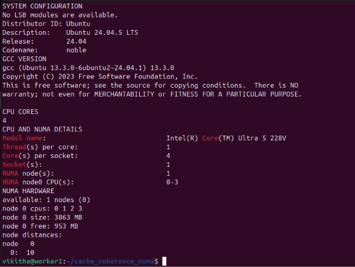
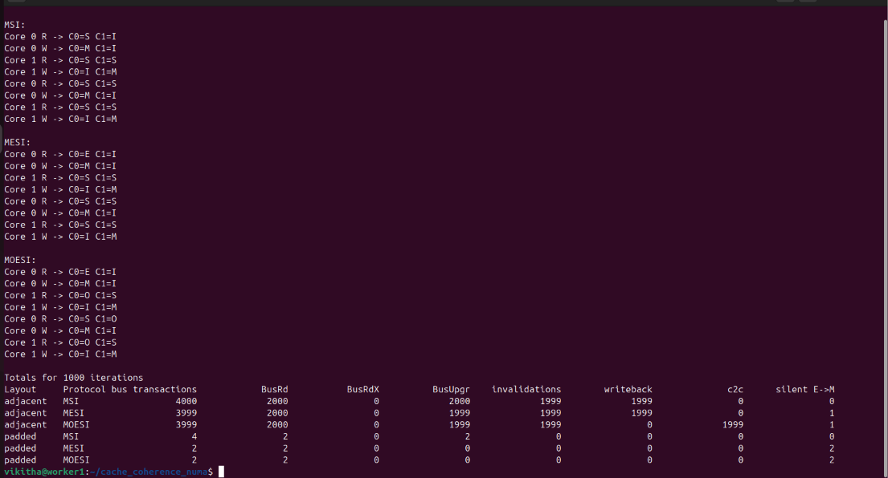
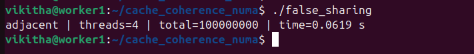
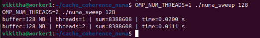
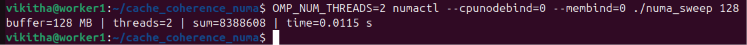
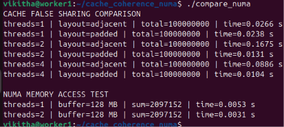

# PGC Experiment 4: Cache Coherence and NUMA Memory Performance

  -orange)

A hands-on study of cache-coherence protocols (MSI, MESI, MOESI), the false-sharing problem in multicore processors, and memory-access performance using OpenMP and NUMA tools.

---

## Table of Contents

1. [Aim](#aim)
2. [Background](#background)
3. [Repository Structure](#repository-structure)
4. [Prerequisites](#prerequisites)
5. [Build and Run](#build-and-run)
6. [Experimental Results](#experimental-results)
7. [Analysis](#analysis)
8. [Limitations](#limitations)
9. [Screenshots](#screenshots)
10. [Conclusion](#conclusion)

---

## Aim

To study cache-coherence protocols (MSI, MESI and MOESI), understand false sharing in multicore processors, and analyze memory-access performance using OpenMP and NUMA tools.

---

## Background

### 1. Cache Coherence

Each CPU core has its own cache. When several cores access the same memory location, their cached copies must remain consistent. Cache-coherence protocols manage these copies and prevent cores from using stale data.

| Protocol | States | Key Characteristic |
|---|---|---|
| **MSI** | Modified, Shared, Invalid | Simplest; a private line needs a bus upgrade before its first write. |
| **MESI** | Modified, Exclusive, Shared, Invalid | The Exclusive state allows a silent E→M transition, saving a bus transaction for private data. |
| **MOESI** | Modified, Owned, Exclusive, Shared, Invalid | The Owned state lets a core supply a dirty line directly (cache-to-cache), avoiding a forced write-back to memory. |

`coherence_sim.py` simulates cache-state transitions and counts coherence-related events (BusRd, BusRdX, BusUpgr, invalidations, write-backs, cache-to-cache transfers, silent E→M writes).

> **Note:** This is a software simulation. It is not a direct measurement of the processor's physical cache-coherence protocol.

### 2. False Sharing

False sharing occurs when different threads update *different* variables that happen to occupy the *same* cache line. Although the variables are logically independent, coherence traffic makes the line bounce between cores and degrades performance.

Two layouts are compared:

- **Adjacent layout:** counters are stored next to each other (share a cache line).
- **Padded layout:** counters are separated so each sits on its own cache line.

### 3. NUMA (Non-Uniform Memory Access)

In NUMA systems, memory-access time depends on whether a CPU accesses memory attached to its own node (local) or to another node (remote). OpenMP and `numactl` are used to vary thread counts and CPU/memory binding.

---

## Repository Structure

```
.
├── coherence_sim.py      # MSI / MESI / MOESI cache-coherence simulator
├── false_sharing.c       # Adjacent vs padded counters (OpenMP)
├── numa_sweep.c          # Memory-scan benchmark with thread count and NUMA binding
├── compare_numa.c        # Combined false-sharing and memory-sweep test
├── screenshots/          # Evidence of execution (see Screenshots section)
└── README.md
```

| File | Description |
|---|---|
| `coherence_sim.py` | Simulates MSI, MESI and MOESI cache-coherence protocols. |
| `false_sharing.c` | Compares adjacent and padded counters using OpenMP. |
| `numa_sweep.c` | Measures memory-scan performance with different thread counts and NUMA binding. |
| `compare_numa.c` | Combines false-sharing and NUMA memory-access tests. |

---

## Prerequisites

- Ubuntu Linux (tested in a VMware virtual machine)
- Python 3
- GCC with OpenMP support (`gcc -fopenmp`)
- `numactl` / `libnuma`

Install the tools on Ubuntu:

```bash
sudo apt update
sudo apt install -y build-essential python3 numactl
```

Check the NUMA topology and core count of your machine before running:

```bash
lscpu
numactl --hardware
```

---

## Build and Run

### 1. Cache-Coherence Simulation

```bash
python3 coherence_sim.py 1000
```

The optional argument is the number of iterations (default: 1000). The program prints a state trace for the first two iterations, followed by total event counts for each protocol under the adjacent and padded layouts.

### 2. False-Sharing Test

```bash
gcc -O2 -fopenmp false_sharing.c -o false_sharing
./false_sharing
```

### 3. NUMA Memory Sweep

```bash
gcc -O2 -fopenmp numa_sweep.c -o numa_sweep

# One thread
OMP_NUM_THREADS=1 ./numa_sweep 128

# Two threads
OMP_NUM_THREADS=2 ./numa_sweep 128

# Two threads, CPU and memory bound to NUMA node 0
OMP_NUM_THREADS=2 numactl --cpunodebind=0 --membind=0 ./numa_sweep 128
```

The argument `128` is the buffer size in MB.

On a multi-node machine, local and remote placement can be compared by changing `--membind`:

```bash
# Local memory
OMP_NUM_THREADS=2 numactl --cpunodebind=0 --membind=0 ./numa_sweep 128
# Remote memory (requires a second NUMA node)
OMP_NUM_THREADS=2 numactl --cpunodebind=0 --membind=1 ./numa_sweep 128
```

### 4. Combined Performance Test

```bash
gcc -O2 -fopenmp compare_numa.c -o compare_numa
./compare_numa
```

---

## Experimental Results

All results were obtained in an Ubuntu VMware environment. Timings depend on the machine, the VM and the number of cores, so absolute values will vary between systems.

### False-Sharing Comparison (100,000,000 total updates)

| Program | Layout | Threads | Time (s) |
|---|---|---:|---:|
| `false_sharing` | Adjacent | 2 | 0.0463 |
| `false_sharing` | Padded | 2 | 0.0295 |
| `compare_numa` | Adjacent | 1 | 0.0625 |
| `compare_numa` | Padded | 1 | 0.0669 |
| `compare_numa` | Adjacent | 2 | 0.0483 |
| `compare_numa` | Padded | 2 | 0.0271 |
| `compare_numa` | Adjacent | 4 | 0.0507 |
| `compare_numa` | Padded | 4 | 0.0290 |

**Cost of false sharing (adjacent time ÷ padded time):**

| Program | Threads | Ratio |
|---|---:|---:|
| `false_sharing` | 2 | ≈ 1.57× |
| `compare_numa` | 1 | ≈ 0.93× |
| `compare_numa` | 2 | ≈ 1.78× |
| `compare_numa` | 4 | ≈ 1.75× |

### NUMA Memory-Access Comparison

| Program | Configuration | Threads | Buffer | Sum | Time (s) |
|---|---|---:|---:|---:|---:|
| `numa_sweep` | Default | 1 | 128 MB | 8,388,608 | 0.0314 |
| `numa_sweep` | Default | 2 | 128 MB | 8,388,608 | 0.0221 |
| `numa_sweep` | Node 0 binding (`--cpunodebind=0 --membind=0`) | 2 | 128 MB | 8,388,608 | 0.0219 |
| `compare_numa` | Default | 1 | 128 MB | 2,097,152 | 0.0080 |
| `compare_numa` | Default | 2 | 128 MB | 2,097,152 | 0.0059 |

**Speed-up from 1 to 2 threads:** ≈ 1.42× (`numa_sweep`) and ≈ 1.36× (`compare_numa`).

---

## Analysis

### Cache-Coherence Simulation (expected behaviour)

| Protocol | Behaviour | Scalability |
|---|---|---|
| MSI | More bus traffic; even a private line needs an upgrade before its first write. | Same traffic growth as MESI when lines are shared. |
| MESI | Fewer transactions for private data thanks to the silent E→M transition. | Good for private data; same ping-pong on shared lines. |
| MOESI | No forced write-back to memory; the owner supplies the line cache-to-cache. | Good; lowest memory traffic of the three. |

The exact event counts for each protocol and layout are produced by `coherence_sim.py` (see Screenshot 2).

### False Sharing

- With **two and four threads**, padded counters were consistently faster (roughly 1.6–1.8× in these runs), because each core can keep its own cache line in the Modified state without invalidating the other cores' lines.
- With **one thread**, padding gave no benefit (0.0625 s adjacent vs 0.0669 s padded). There is no second core to contend for the line, so the small difference is within normal run-to-run variation.
- The adjacent layout did not improve as threads were added (0.0483 s at 2 threads, 0.0507 s at 4 threads), which is the typical signature of false sharing.

### NUMA and Thread Scaling

- Two threads completed the memory sweep faster than one thread in both programs.
- Binding to NUMA node 0 gave essentially the same time as the unbound run (0.0219 s vs 0.0221 s), which is expected on a system with a single node.

---

## Limitations

- **Single NUMA node:** The VMware environment exposes only node 0, so **remote-versus-local memory performance could not be compared**. The results therefore show thread scaling and the mechanics of node binding, not remote-access penalties.
- **Virtualised hardware:** The VM may not reflect the physical core topology, so timings may differ on bare-metal or multi-socket systems.
- **Single, short runs:** Execution times are in the tens of milliseconds and were not averaged over repeated runs; small differences (such as the 1-thread adjacent/padded result) should not be over-interpreted.
- **Simulation scope:** `coherence_sim.py` models protocol state transitions in software and does not measure real hardware behaviour.
- **Parameter differences:** The lab manual's reference output uses a 512 MB, 4-pass sweep, whereas the runs recorded here used a 128 MB buffer.

---

## Screenshots

### 1. System Configuration


### 2. Cache Coherence Simulation: MSI, MESI and MOESI


### 3. False Sharing Comparison: Adjacent vs Padded


### 4. NUMA Thread Comparison


### 5. NUMA Node Binding


### 6. Combined Performance Comparison


---

## Conclusion

All three protocols keep caches correct; they differ in the amount of bus traffic they require. The simulation shows that MESI avoids the upgrade transaction for data used by only one core, and that MOESI avoids writing a dirty line back to memory when another core reads it, by letting the owner supply the line directly.

The false-sharing experiment shows that coherence operates on whole cache lines: when independent counters share a line, it ping-pongs between cores, and padding the counters onto separate lines removes this cost in multithreaded runs.

The NUMA tests demonstrate thread-based memory-access measurement and node binding. Because only one NUMA node was available, the cost of remote memory could not be measured. On multi-socket systems, threads and their memory should be placed on the same node (`numactl --cpunodebind` and `--membind`, or first-touch allocation). Data layout and placement therefore matter as much as the choice of protocol for the scalability of a parallel program.
